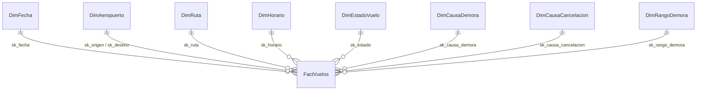
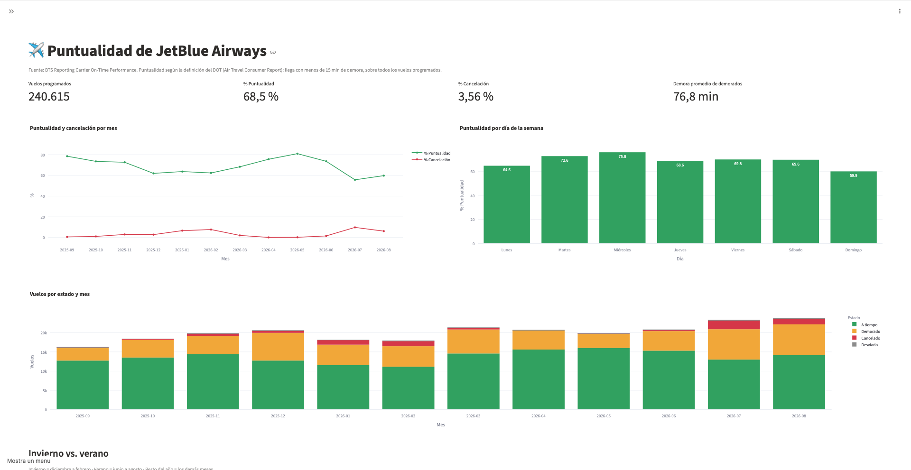
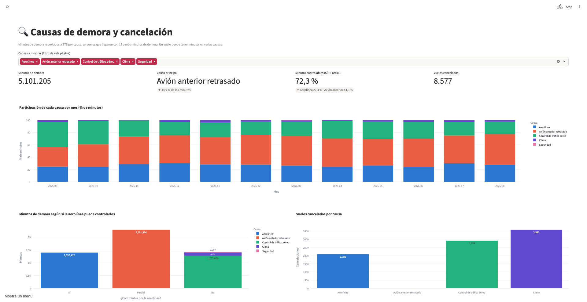
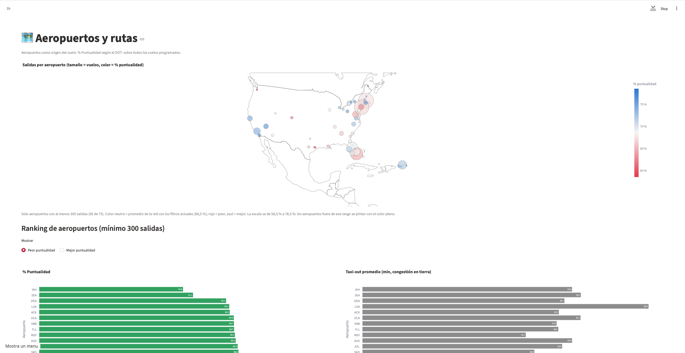
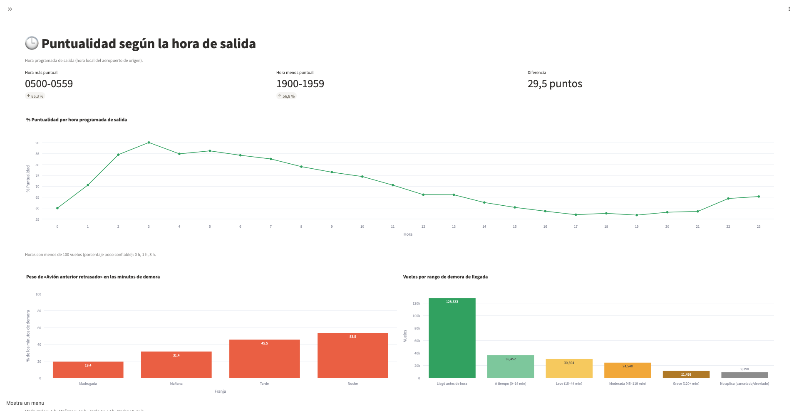
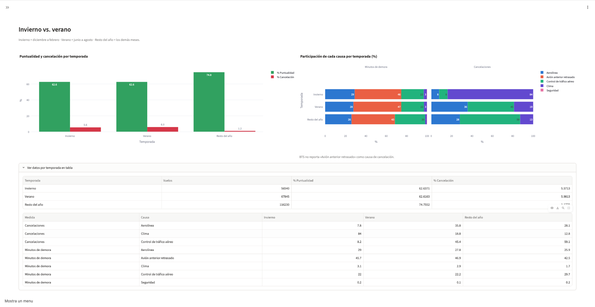
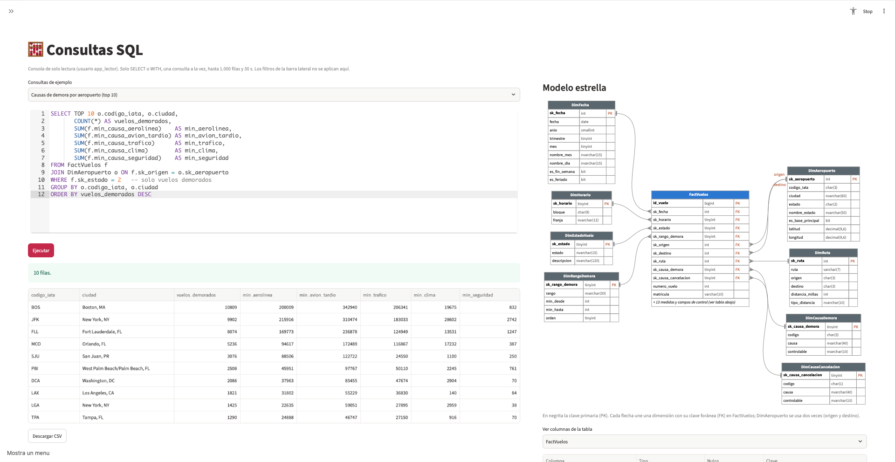
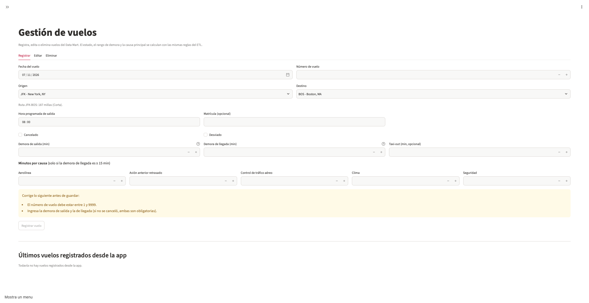
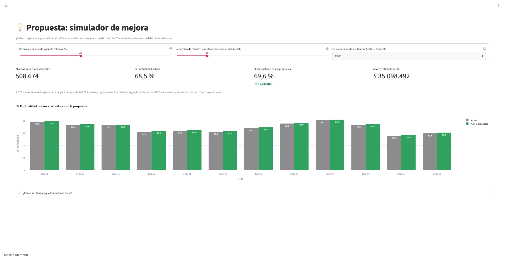

# Data Mart de Puntualidad de JetBlue Airways

Proyecto final — Business Intelligence · Universidad del Pacífico · 2026-2

| | |
|---|---|
| **Empresa** | JetBlue Airways (código `B6`) |
| **Proceso** | Operación de vuelos domésticos en EE. UU. |
| **Fuente** | Bureau of Transportation Statistics (BTS), *Reporting Carrier On-Time Performance*. Datos reales y públicos |
| **Periodo** | Últimos 12 meses publicados (sep-2025 a ago-2026, ajustar al descargar) |
| **Stack** | Python (pandas, pyodbc) · Azure SQL Database · Streamlit en Azure App Service |
| **Dashboard** | `https://<app>.azurewebsites.net` *(completar)* |

---

## 1. Marco teórico

**Business Intelligence (BI)** es el conjunto de procesos y herramientas que convierten datos operativos en información para tomar decisiones. Su idea central es separar dos tipos de sistemas:

| | Sistema transaccional (OLTP) | Sistema analítico (OLAP) |
|---|---|---|
| Para qué sirve | Registrar operaciones del día a día | Analizar el historial |
| Consultas típicas | Leer o escribir pocas filas | Resumir millones de filas |
| Diseño | Normalizado (muchas tablas pequeñas) | Dimensional (pocas tablas, más redundancia) |

Los datos del BTS son un archivo plano por mes con más de 100 columnas: útiles para registrar, poco prácticos para analizar. Este proyecto los transforma en un **data mart**: un almacén pequeño y enfocado en un solo tema, la puntualidad.

**Modelado dimensional (Kimball).** Toda pregunta de negocio se separa en:
- **Hechos:** lo que se mide (minutos de demora, si se canceló o no).
- **Dimensiones:** el contexto desde el que se mira (cuándo, dónde, a qué hora, por qué causa).

El diseño sigue los 4 pasos de Kimball: (1) elegir el proceso, (2) definir el **grano** (qué representa una fila), (3) elegir dimensiones, (4) elegir hechos. Se usa un **esquema estrella**: una tabla de hechos al centro unida directamente a cada dimensión, lo que simplifica las consultas y las acelera.

Conceptos aplicados en este modelo:
- **Clave subrogada:** identificador numérico propio del data mart (`sk_…`), independiente de los códigos de la fuente.
- **Dimensión role-playing:** una misma tabla usada con dos roles; `DimAeropuerto` es origen y destino.
- **Dimensión degenerada:** dato de identificación guardado en la tabla de hechos sin tabla propia (número de vuelo, matrícula).
- **Aditividad:** los conteos y minutos se pueden sumar; los porcentajes no. Los KPI se calculan siempre como *suma ÷ suma*, nunca como promedio de porcentajes.
- **ETL (Extract, Transform, Load):** extraer los CSV del BTS, transformarlos (limpiar, derivar estados y causas) y cargarlos al data mart.

**KPI de la industria aérea.** El DOT considera **puntual** un vuelo que llega con menos de 15 minutos de retraso. Las aerolíneas reportan la demora en 5 causas: aerolínea, clima, control de tráfico aéreo (NAS), seguridad y avión anterior retrasado.

## 2. Descripción de la empresa y problemática

**JetBlue Airways** es una aerolínea estadounidense con base en Nueva York (JFK). Sus principales operaciones están en el noreste de EE. UU., Florida y el Caribe.

**Problemática.** JetBlue está entre las aerolíneas menos puntuales de EE. UU. Según el *Air Travel Consumer Report* del DOT, en el primer semestre de 2026 llegó a tiempo en el 71 % de sus vuelos (8.º de 9 aerolíneas), y en julio de 2026 bajó a 55,7 % (último lugar) con 9,8 % de vuelos cancelados *(verificar el ranking con el ATCR oficial; los porcentajes coinciden con nuestros datos)*. Cada demora genera costos de tripulación, combustible, compensaciones y pérdida de clientes.

**Situación según los datos (BTS, sep-2025 a ago-2026, 240.615 vuelos de JetBlue).** Usamos la misma definición del *Air Travel Consumer Report* del DOT: un vuelo es **puntual** si llega con menos de 15 minutos de retraso, y la puntualidad se calcula sobre **todos los vuelos programados** (los cancelados y desviados cuentan como no puntuales). Con esta definición, nuestros datos reproducen las cifras del DOT: **71,0 %** de puntualidad en el primer semestre de 2026 y **55,7 %** en julio de 2026, con **9,8 %** de cancelaciones.

En todo el periodo JetBlue fue puntual en el **68,5 %** de sus vuelos y canceló el **3,6 %** (8.577 vuelos). El desempeño cae en invierno y en verano: en diciembre de 2025 y en enero y febrero de 2026 la puntualidad bajó a **62–64 %**, con cancelaciones de hasta **7,7 %** (febrero), y el verano de 2026 fue el peor periodo: julio (**55,7 %** puntual, **9,8 %** cancelado) y agosto (**59,8 %** puntual, **6,2 %** cancelado). El mejor mes fue mayo de 2026 (81,0 % puntual, 0,2 % cancelado).

Más de uno de cada cuatro vuelos operados (**29 %**) llega con 15 minutos o más de demora, y el 4,8 % de todos los vuelos llega con más de dos horas. Por minutos de demora, la causa principal es el **avión anterior retrasado (45 %)**: una demora temprana se arrastra al resto del día. Le siguen la **propia aerolínea (27 %)** y el **control de tráfico aéreo (25 %)**. El clima extremo explica solo el 2 % de los minutos de demora, pero el **42 % de las cancelaciones**. En total, más del 70 % de los minutos de demora dependen total o parcialmente de JetBlue (aerolínea + avión anterior), lo que deja un amplio margen de mejora operativa.

La empresa tiene los datos de cada vuelo, pero no una vista integrada que responda:

1. ¿Cómo evoluciona la puntualidad y la cancelación mes a mes?
2. ¿Qué causa explica la mayor parte de los minutos de demora? ¿Cuánto depende de la propia aerolínea?
3. ¿En qué aeropuertos y rutas se concentran las demoras?
4. ¿Empeora la puntualidad a lo largo del día (efecto "en cadena")?
5. ¿Cuánto se ahorraría reduciendo las causas controlables?

**Objetivo.** Construir un data mart y un dashboard web que respondan estas preguntas y sustenten una propuesta de mejora.

## 3. Modelamiento dimensional

| Paso de Kimball | Decisión |
|---|---|
| Proceso | Operación de vuelos domésticos de JetBlue |
| Grano | Un vuelo programado (incluye cancelados y desviados) |
| Dimensiones | 8 |
| Hechos | 11 métricas |

### Diccionario de datos

**D1 DimFecha**
| Campo | Descripción |
|---|---|
| sk_fecha | Fecha como número AAAAMMDD |
| fecha | Fecha del vuelo |
| anio, trimestre, mes | Partes de la fecha |
| nombre_mes, nombre_dia | Nombres en español |
| es_fin_semana | 1 si es sábado o domingo |
| es_feriado | 1 si es feriado federal de EE. UU. |

**D2 DimAeropuerto** (origen y destino)
| Campo | Descripción |
|---|---|
| sk_aeropuerto | Clave subrogada |
| codigo_iata | Código del aeropuerto (JFK, BOS…). En agosto de 2026 BTS cambió el código de Palm Beach (FL) de PBI a DJT porque el aeropuerto fue renombrado. Como es el mismo aeropuerto, el ETL reemplaza DJT por PBI (el código de 11 de los 12 meses) para no partirlo en dos. |
| ciudad, estado, nombre_estado | Ubicación |
| es_base_principal | 1 si está entre los 5 aeropuertos con más salidas de JetBlue |
| latitud, longitud | Coordenadas del aeropuerto para el mapa (fuente pública: OurAirports, `airports.csv`) |

**D3 DimRuta**
| Campo | Descripción |
|---|---|
| sk_ruta | Clave subrogada |
| ruta | "JFK-BOS" |
| origen, destino | Códigos de los aeropuertos |
| distancia_millas | Distancia de la ruta |
| tipo_distancia | Corta (<700 mi), Media (700–1500), Larga (>1500) |

**D4 DimHorario**
| Campo | Descripción |
|---|---|
| sk_horario | Hora programada de salida (0–23) |
| bloque | Intervalo, ej. "0600-0659" |
| franja | Madrugada, Mañana, Tarde, Noche |

**D5 DimEstadoVuelo**: A tiempo · Demorado (≥15 min) · Cancelado · Desviado.

**D6 DimCausaDemora**: causa con más minutos de demora (Aerolínea, Clima, Control de tráfico aéreo, Seguridad, Avión anterior retrasado; más Sin demora, No aplica y Sin dato) y si es controlable por la aerolínea.

**D7 DimCausaCancelacion**: No cancelado · Aerolínea · Clima · Control de tráfico aéreo · Seguridad, con su controlabilidad.

**D8 DimRangoDemora**: Llegó antes · A tiempo (0–14) · Leve (15–44) · Moderada (45–119) · Grave (120+) · No aplica.

**FactVuelos**
| Campo | Descripción |
|---|---|
| id_vuelo | Identificador de la fila |
| sk_… (9 claves) | Enlaces a las dimensiones (aeropuerto 2 veces) |
| numero_vuelo, matricula | Número de vuelo y avión (dimensiones degeneradas) |
| demora_salida_min | Minutos de retraso al salir (negativo = salió antes) |
| demora_llegada_min | Minutos de retraso al llegar (negativo = llegó antes) |
| taxi_out_min | Minutos desde la puerta hasta despegar (congestión) |
| es_puntual, es_cancelado, es_desviado | Indicadores 0/1 |
| min_causa_aerolinea, _clima, _trafico, _seguridad, _avion_tardio | Minutos de demora por causa (solo vuelos con ≥15 min) |
| origen_registro | ETL o APP (registrado desde el dashboard) |
| fecha_carga | Fecha de carga |

Especificación completa (tipos, reglas y DDL): [`docs/01_modelo_dimensional.md`](docs/01_modelo_dimensional.md).

### KPI
| KPI | Cálculo |
|---|---|
| % Puntualidad | vuelos a tiempo ÷ vuelos programados (cancelados y desviados cuentan como no puntuales; definición del *Air Travel Consumer Report* del DOT) |
| % Cancelación | vuelos cancelados ÷ vuelos programados |
| Demora promedio | promedio de minutos de llegada de los vuelos demorados |
| Participación de causa | minutos de la causa ÷ minutos de las 5 causas |
| Taxi-out promedio | promedio de minutos de rodaje en la salida |

## 4. Diseño y análisis de resultados de BI

El dashboard (Streamlit en Azure App Service) consulta en vivo el data mart `VuelosDW` y tiene 7 páginas con filtros globales (fechas, origen, destino, distancia, franja horaria y tipo de día). Cifras de sep-2025 a ago-2026, **240.615 vuelos**, sin filtros salvo que se indique.

### 4.1 Resumen
 *(captura pendiente)*

- Puntualidad **68,5 %**, cancelación **3,6 %**, demora promedio de los vuelos demorados **76,8 min**.
- Solo el 68,5 % llega bajo 15 min; el **4,8 %** de los vuelos llega con más de 2 horas de demora.
- El **tipo de día** importa (filtro global «Tipo de día»): días laborables **70,4 %**, fines de semana **64,6 %** y feriados **62,0 %**.
- La **distancia** casi no cambia el resultado (filtro «Tipo de distancia»: corta 67,6 %, media 68,0 %, larga 70,2 %): el problema es operativo, no de la ruta en sí.

### 4.2 Causas de demora
 *(captura pendiente)*

| Causa (minutos de demora) | % | Controlable |
|---|---|---|
| Avión anterior retrasado | **44,9 %** | Parcial |
| Aerolínea | **27,4 %** | Sí |
| Control de tráfico aéreo | 25,0 % | No |
| Clima | 2,5 % | No |
| Seguridad | 0,2 % | No |

- **72,3 %** de los minutos (≈ 3,7 millones) dependen total o parcialmente de JetBlue.
- La mezcla es estable todo el año: «Avión anterior retrasado» está entre 32 % y 50 % todos los meses.
- **Cancelaciones (8.577):** clima 41,8 %, control de tráfico aéreo 33,9 %, aerolínea 24,3 %.

### 4.3 Aeropuertos y rutas
 *(captura pendiente)*

- **Bases principales:** BOS 67,5 %, JFK 67,0 %, **FLL 64,7 %** (la peor), MCO 69,1 %, SJU 71,7 %.
- **Peores aeropuertos** (mín. 300 vuelos): IAH **47,8 %**, SEA 51,1 %, DEN 62,1 %, LGA 63,1 %, ACK 63,3 % (7,3 % cancelado). Los mejores: PQI 87,4 % y PSE 86,8 %.
- **Congestión en Nueva York:** el taxi-out promedio es **27,2 min en JFK** y **26,4 min en LGA**, frente a 12–13 min en Puerto Rico (SJU, BQN, PSE).
- **Rutas con más minutos de demora:** DCA-BOS (81.076 min), JFK-LAX (67.260), MCO-BOS (63.595), BOS-DCA (62.277). Son rutas de alta frecuencia: pocas rutas concentran mucho costo.
- **Rutas menos puntuales** (mín. 100 vuelos): IAH-JFK **37,4 %**, SEA-BOS 42,1 %, IAH-FLL 42,2 %.
- Los datos de un aeropuerto están en la tabla «Ver datos de aeropuertos». Los de una ruta (p. ej. DCA-BOS, 60,0 % puntual; IAH-JFK, 10,2 % cancelado) se ven en Resumen filtrando el origen y el destino.

### 4.4 Horario: efecto en cadena
 *(captura pendiente)*

- La puntualidad cae casi sin pausa durante el día: **84,3 %** a las 6 h → **66,2 %** a las 12 h → **56,8 %** a las 19 h (−27,5 puntos).
- En la misma línea sube el peso de «Avión anterior retrasado» en los minutos de demora: **31,4 %** en la mañana, 45,5 % en la tarde y **53,5 %** en la noche.
- Conclusión: una demora temprana se arrastra en la rotación del avión. Cortar la cadena en la mañana es la palanca de mayor impacto.

### 4.5 Temporadas: invierno vs. verano
 *(captura pendiente)*

Sección «Invierno vs. verano» de la página Resumen y gráfico «Vuelos cancelados por mes y causa» de la página Causas.

| Temporada | Puntualidad | Cancelación | Causa principal de las cancelaciones |
|---|---|---|---|
| Invierno (dic–feb) | 62,6 % | 5,6 % | **Clima (84 %)** |
| Verano (jun–ago) | 62,6 % | 6,0 % | **Tráfico aéreo (45 %) y aerolínea (36 %)** |
| Resto del año | 74,8 % | 1,2 % | Tráfico aéreo (59 %) |

- Las dos temporadas tienen la misma puntualidad, pero por razones distintas: en invierno manda el clima (no controlable); en verano, la congestión y la **propia aerolínea**.
- **Julio de 2026** fue el peor mes: 9,8 % cancelado (2.279 vuelos), de los cuales **754 por causa de la aerolínea**. Agosto: 582. El resto del año, menos de 250 por mes.

### 4.6 Consultas SQL y Gestión de vuelos
 *(captura pendiente)*
 *(captura pendiente)*

- **Consultas SQL:** consola de solo lectura (usuario `app_lector`) con diagrama estrella y consultas de ejemplo, para que un analista responda preguntas nuevas sin tocar el código.
- **Gestión de vuelos:** registrar, editar y eliminar vuelos (usuario `app_editor`), aplicando las mismas reglas del ETL (`src/reglas.py`).

### 4.7 Propuesta de mejora
 *(captura pendiente)*

**Simulador.** Para cada vuelo demorado real, la página resta un % de sus minutos de «Aerolínea» y de «Avión anterior retrasado»; si la nueva demora queda bajo 15 min, el vuelo pasa a puntual. Ahorro = minutos ahorrados × costo por minuto.

| Escenario (reducción Aerolínea / Avión anterior) | Puntualidad | Vuelos que pasan a puntuales | Minutos ahorrados | Ahorro (USD) ⚠️ |
|---|---|---|---|---|
| Actual | 68,5 % | — | — | — |
| Conservador (10 % / 10 %) | 69,2 % | 1.735 | 368.932 | 25,5 M |
| **Base (20 % / 10 %)** | **69,6 %** | **2.577** | **508.673** | **35,1 M** |
| Ambicioso (30 % / 30 %) | 70,6 % | 4.988 | 1.106.797 | 76,4 M |

⚠️ *Supuesto: 69 USD por minuto (ver abajo).*

**Lectura.** El ahorro en minutos y costos es grande, pero la puntualidad sube poco (+1 a +2 puntos), porque la demora promedio de los demorados es 76,8 min: reducirla un 20 % no la deja bajo 15 min. Para mover el KPI del DOT se necesita además **evitar que la demora empiece** (primer vuelo del día) y bajar las cancelaciones de verano.

**Acciones propuestas**

| # | Acción | Causa que ataca | Plazo | Recursos |
|---|---|---|---|---|
| 1 | **Primer vuelo del día protegido:** salida puntual de las 5–7 h en BOS, JFK y FLL (rampa y tripulación listas 15 min antes, chequeo de mantenimiento la noche anterior). En el periodo hubo 17.050 salidas en esa franja en las tres bases. | Avión anterior, Aerolínea | Mes 1–3 | 3 supervisores de rampa extra por base |
| 2 | **Colchones en la rotación de la tarde:** +10 min de tiempo en tierra en las salidas de 12–20 h de las rutas con más minutos de demora (DCA-BOS, BOS-DCA, MCO-BOS, BOS-MCO, JFK-LAX, MCO-JFK). | Avión anterior | Mes 2–5 (programación de verano 2027) | Equipo de planificación de red |
| 3 | **Aviones y tripulaciones de reserva** en JFK y BOS de junio a agosto. | Aerolínea (cancelaciones de verano), Avión anterior | Mes 4–6 (antes del verano) | 2 aviones y 4 tripulaciones de guardia |
| 4 | **Programa de turnaround:** metas de embarque, equipaje y limpieza por base, con seguimiento semanal. | Aerolínea | Mes 1–12 | 4 especialistas de capacitación, curso para el personal de tierra |
| 5 | **Centro de control con este dashboard:** revisión semanal por base, hora y ruta; alertas cuando una base cae bajo la meta. | Todas (seguimiento) | Mes 1 en adelante | 1 analista de datos, Azure SQL + App Service |

**Cálculo de costos (primer año).** Cada costo es *cantidad × costo unitario*. Los sueldos son medianas anuales de BLS (mayo 2025) y se convierten a costo para la empresa dividiendo entre **0,70**, porque según BLS (ECEC, junio 2026) los sueldos son el 70,0 % del costo laboral total (el resto son beneficios). El costo del avión usa el desglose de A4A (2025) por minuto de *block time*. Las cantidades marcadas con ⚠️ son supuestos del equipo, sin fuente.

| # | Concepto | Cálculo | Costo (USD) |
|---|---|---|---|
| 1 | Supervisores de rampa | 9 ⚠️ × 58.170 (mediana BLS, *Aircraft cargo handling supervisors*) ÷ 0,70 | 747.900 |
| 2 | Avión detenido más tiempo en tierra | 8.920 salidas (dato del data mart, 12–20 h, 6 rutas) × 10 min ⚠️ × 9,76 (A4A, propiedad del avión por minuto) | 870.592 |
| 3a | Aviones de reserva | 2 ⚠️ × 92 días × 600 min/día ⚠️ (10 h de uso diario) × 9,76 (A4A, propiedad del avión por minuto) | 1.077.504 |
| 3b | Tripulaciones de guardia | 4 ⚠️ × (2 pilotos × 232.140 + 4 TCP × 63.580) (medianas BLS) ÷ 0,70 × 92/365 | 1.035.009 |
| 4a | Especialistas de capacitación | 4 ⚠️ × 69.280 (mediana BLS, *Training and development specialists*) ÷ 0,70 | 395.886 |
| 4b | Horas de capacitación | 1.500 trabajadores ⚠️ × 8 h ⚠️ × 46,89 (BLS ECEC, costo laboral promedio por hora) | 562.680 |
| 5 | Analista de datos + nube | 1 × 120.230 (mediana BLS, *Data scientists*) ÷ 0,70 + 1.200 de Azure ⚠️ (100/mes) | 172.957 |
| | **Total** | | **4.862.528** |

**Notas sobre el cálculo**
- En las acciones 2 y 3a solo se cuenta la **propiedad del avión** (9,76 USD/min de A4A), no combustible ni mantenimiento, porque el avión está detenido. Es un supuesto que la tripulación no cobra extra por esos minutos en tierra.
- En la acción 2 no se cuentan los ingresos perdidos por volar menos: eso subestima el costo.
- Las tripulaciones de reserva podrían salir de la plantilla actual. Aquí se cuentan como costo nuevo, por prudencia.

**Beneficio/costo.** El ahorro del escenario base es 508.673 min × 69 USD = **35,1 M USD**, frente a **4,86 M USD** de costo: **≈ 7,2 veces**. Aun si el costo real fuera el doble, la propuesta se paga sola. La meta del primer año es el escenario base (69,6 %); el escenario ambicioso queda como meta a dos años.

**Cronograma (12 meses)**

| Acción | M1 | M2 | M3 | M4 | M5 | M6 | M7–M12 |
|---|---|---|---|---|---|---|---|
| 5. Centro de control | ■ | ■ | ■ | ■ | ■ | ■ | ■ |
| 1. Primer vuelo protegido | ■ | ■ | ■ | | | | seguimiento |
| 4. Turnaround | ■ | ■ | ■ | ■ | ■ | ■ | ■ |
| 2. Colchones de la tarde | | ■ | ■ | ■ | ■ | | vigente en verano |
| 3. Reservas de verano | | | | ■ | ■ | ■ | jun–ago |

### Supuesto de costo del simulador (página Propuesta)
El ahorro en USD se calcula como *minutos de demora ahorrados × costo por minuto*. El costo por defecto es **69 USD por minuto**, tomado de Airlines for America (A4A), *U.S. Passenger Carrier Delay Costs* (2025): la industria estima **98,41 USD por minuto de *block time***, de los cuales **29,34 USD son combustible** (98,41 − 29,34 ≈ 69). Se excluye el combustible como criterio conservador, ya que parte de la demora puede ocurrir en puerta sin consumo de combustible. Es un promedio de la industria, no un dato propio de JetBlue, por lo que el ahorro debe leerse como orden de magnitud. El valor es editable en la página.

**Limitaciones del simulador:** aplica la misma reducción a todos los vuelos; no recalcula el efecto en cadena sobre los vuelos siguientes del mismo avión (por eso subestima la mejora); no simula cancelaciones; es un escenario "qué pasaría si" sobre datos históricos, no un modelo predictivo.

## 5. Conclusiones
1. JetBlue llegó a tiempo en solo el **68,5 %** de sus vuelos en los últimos 12 meses, y el data mart reproduce las cifras oficiales del DOT (71,0 % en el primer semestre de 2026 y 55,7 % en julio de 2026), lo que valida el ETL y el modelo.
2. El problema es mayormente **controlable**: el 72,3 % de los minutos de demora se debe a la aerolínea o al avión anterior retrasado; el clima explica solo el 2,5 %.
3. La demora **se encadena durante el día**: la puntualidad cae de 84 % a las 6 h a 57 % a las 19 h, mientras «Avión anterior retrasado» sube de 31 % a 53 % de los minutos.
4. Invierno y verano tienen la misma puntualidad (62,6 %) por causas distintas: el clima en invierno, la congestión y la propia operación en verano (754 cancelaciones de la aerolínea solo en julio).
5. El costo de las demoras se concentra en las bases (BOS, JFK, FLL) y en pocas rutas de alta frecuencia (DCA-BOS, JFK-LAX, MCO-BOS).
6. Reducir las causas controlables ahorra mucho dinero (≈ 35 M USD en el escenario base, frente a ≈ 4,9 M USD de costo de las acciones) pero mueve poco el KPI del DOT, porque los vuelos demorados se atrasan en promedio 77 min.

## 6. Recomendaciones
1. **Proteger la salida del primer vuelo del día** en BOS, JFK y FLL: es la forma más barata de cortar la cadena de demoras.
2. **Agregar colchones de tiempo en tierra** en la rotación de la tarde de las rutas con más minutos de demora, y programar el verano con capacidad realista.
3. **Tener aviones y tripulaciones de reserva** en JFK y BOS de junio a agosto para reducir las cancelaciones atribuibles a la aerolínea.
4. **Usar el dashboard como herramienta de gestión semanal**, con metas por base y franja horaria, y medir con la misma definición del DOT para poder compararse con la industria.
5. **Ampliar el data mart** con datos que hoy no tenemos: costos internos de JetBlue, rotación de cada avión (para medir el efecto en cadena real) y datos de otras aerolíneas para comparar.
6. **Validar los supuestos** (costo por minuto y costo de las acciones) con el área de finanzas antes de aprobar el presupuesto.

---

## Cómo ejecutar
Ver [`PLAN_DE_ACCION.md`](PLAN_DE_ACCION.md) y [`docs/04_despliegue_azure.md`](docs/04_despliegue_azure.md).

### Reiniciar Streamlit después de cambiar el código
Streamlit vuelve a ejecutar la página al guardar un archivo (aparece **"Source file changed" → Rerun**
arriba a la derecha; con **Always rerun** lo hace solo). Pero eso **no basta** cuando se cambia:
- un módulo importado (`app/db.py`, `app/esquema.py`, `src/reglas.py`, `src/conexion.py`),
- el archivo `.env` (credenciales o servidor),
- `app/app.py` (lista de páginas del menú).

En esos casos hay que reiniciar el servidor:
1. En la terminal donde corre Streamlit, presionar **Ctrl + C**.
2. Volver a ejecutar `streamlit run app/app.py`.
3. Recargar el navegador (F5).

Si los datos se ven desactualizados (p. ej. tras correr el ETL), basta con el menú **⋮ → Clear cache**
o la tecla **C** en la página, y luego **R** para volver a ejecutarla.
En Azure App Service: portal → la Web App → **Reiniciar**.

## Referencias
- Kimball, R. & Ross, M. (2013). *The Data Warehouse Toolkit* (3.ª ed.). Wiley.
- Bureau of Transportation Statistics. *Airline On-Time Performance Data*. https://www.transtats.bts.gov/
- U.S. DOT. *Air Travel Consumer Report*. https://www.transportation.gov/individuals/aviation-consumer-protection/air-travel-consumer-reports
- Airlines for America (2025). *U.S. Passenger Carrier Delay Costs*. https://www.airlines.org/dataset/u-s-passenger-carrier-delay-costs/
- Bureau of Labor Statistics (2026). *Occupational Outlook Handbook* (medianas de mayo 2025): [pilotos](https://www.bls.gov/ooh/transportation-and-material-moving/airline-and-commercial-pilots.htm), [tripulantes de cabina](https://www.bls.gov/ooh/transportation-and-material-moving/flight-attendants.htm), [especialistas de capacitación](https://www.bls.gov/ooh/business-and-financial/training-and-development-specialists.htm), [científicos de datos](https://www.bls.gov/ooh/math/data-scientists.htm).
- Bureau of Labor Statistics, OEWS (mayo 2025), vía O*NET OnLine. *Aircraft Cargo Handling Supervisors (53-1041)*. https://www.onetonline.org/link/summary/53-1041.00
- Bureau of Labor Statistics (2026). *Employer Costs for Employee Compensation – June 2026*. https://www.bls.gov/news.release/ecec.nr0.htm
