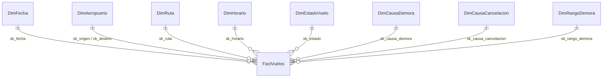

# Data Mart de Puntualidad de JetBlue Airways

Proyecto final — Business Intelligence · Universidad del Pacífico · 2026-2

| | |
|---|---|
| **Empresa** | JetBlue Airways (código `B6`) |
| **Proceso** | Operación de vuelos domésticos en EE. UU. |
| **Fuente** | Bureau of Transportation Statistics (BTS), *Reporting Carrier On-Time Performance*. Datos reales y públicos |
| **Periodo** | Últimos 12 meses publicados (sep-2025 a ago-2026, ajustar al descargar) |
| **Stack** | Python (pandas, pyodbc) · Azure SQL Database · Streamlit en Azure App Service |
| **Dashboard** | `https://<app>.azurewebsites.net` *(completar)* |

---

## 1. Marco teórico

**Business Intelligence (BI)** es el conjunto de procesos y herramientas que convierten datos operativos en información para tomar decisiones. Su idea central es separar dos tipos de sistemas:

| | Sistema transaccional (OLTP) | Sistema analítico (OLAP) |
|---|---|---|
| Para qué sirve | Registrar operaciones del día a día | Analizar el historial |
| Consultas típicas | Leer o escribir pocas filas | Resumir millones de filas |
| Diseño | Normalizado (muchas tablas pequeñas) | Dimensional (pocas tablas, más redundancia) |

Los datos del BTS son un archivo plano por mes con más de 100 columnas: útiles para registrar, poco prácticos para analizar. Este proyecto los transforma en un **data mart**: un almacén pequeño y enfocado en un solo tema, la puntualidad.

**Modelado dimensional (Kimball).** Toda pregunta de negocio se separa en:
- **Hechos:** lo que se mide (minutos de demora, si se canceló o no).
- **Dimensiones:** el contexto desde el que se mira (cuándo, dónde, a qué hora, por qué causa).

El diseño sigue los 4 pasos de Kimball: (1) elegir el proceso, (2) definir el **grano** (qué representa una fila), (3) elegir dimensiones, (4) elegir hechos. Se usa un **esquema estrella**: una tabla de hechos al centro unida directamente a cada dimensión, lo que simplifica las consultas y las acelera.

Conceptos aplicados en este modelo:
- **Clave subrogada:** identificador numérico propio del data mart (`sk_…`), independiente de los códigos de la fuente.
- **Dimensión role-playing:** una misma tabla usada con dos roles; `DimAeropuerto` es origen y destino.
- **Dimensión degenerada:** dato de identificación guardado en la tabla de hechos sin tabla propia (número de vuelo, matrícula).
- **Aditividad:** los conteos y minutos se pueden sumar; los porcentajes no. Los KPI se calculan siempre como *suma ÷ suma*, nunca como promedio de porcentajes.
- **ETL (Extract, Transform, Load):** extraer los CSV del BTS, transformarlos (limpiar, derivar estados y causas) y cargarlos al data mart.

**KPI de la industria aérea.** El DOT considera **puntual** un vuelo que llega con menos de 15 minutos de retraso. Las aerolíneas reportan la demora en 5 causas: aerolínea, clima, control de tráfico aéreo (NAS), seguridad y avión anterior retrasado.

## 2. Descripción de la empresa y problemática

**JetBlue Airways** es una aerolínea estadounidense con base en Nueva York (JFK). Sus principales operaciones están en el noreste de EE. UU., Florida y el Caribe.

**Problemática.** JetBlue está entre las aerolíneas menos puntuales de EE. UU. Según el *Air Travel Consumer Report* del DOT, en el primer semestre de 2026 llegó a tiempo en el 71 % de sus vuelos (8.º de 9 aerolíneas), y en julio de 2026 bajó a 55,7 % (último lugar) con 9,8 % de vuelos cancelados *(verificar cifras con el ATCR oficial)*. Cada demora genera costos de tripulación, combustible, compensaciones y pérdida de clientes.

La empresa tiene los datos de cada vuelo, pero no una vista integrada que responda:

1. ¿Cómo evoluciona la puntualidad y la cancelación mes a mes?
2. ¿Qué causa explica la mayor parte de los minutos de demora? ¿Cuánto depende de la propia aerolínea?
3. ¿En qué aeropuertos y rutas se concentran las demoras?
4. ¿Empeora la puntualidad a lo largo del día (efecto "en cadena")?
5. ¿Cuánto se ahorraría reduciendo las causas controlables?

**Objetivo.** Construir un data mart y un dashboard web que respondan estas preguntas y sustenten una propuesta de mejora.

## 3. Modelamiento dimensional

| Paso de Kimball | Decisión |
|---|---|
| Proceso | Operación de vuelos domésticos de JetBlue |
| Grano | Un vuelo programado (incluye cancelados y desviados) |
| Dimensiones | 8 |
| Hechos | 11 métricas |

### Diccionario de datos

**D1 DimFecha**
| Campo | Descripción |
|---|---|
| sk_fecha | Fecha como número AAAAMMDD |
| fecha | Fecha del vuelo |
| anio, trimestre, mes | Partes de la fecha |
| nombre_mes, nombre_dia | Nombres en español |
| es_fin_semana | 1 si es sábado o domingo |
| es_feriado | 1 si es feriado federal de EE. UU. |

**D2 DimAeropuerto** (origen y destino)
| Campo | Descripción |
|---|---|
| sk_aeropuerto | Clave subrogada |
| codigo_iata | Código del aeropuerto (JFK, BOS…) |
| ciudad, estado, nombre_estado | Ubicación |
| es_base_principal | 1 si está entre los 5 aeropuertos con más salidas de JetBlue |

**D3 DimRuta**
| Campo | Descripción |
|---|---|
| sk_ruta | Clave subrogada |
| ruta | "JFK-BOS" |
| origen, destino | Códigos de los aeropuertos |
| distancia_millas | Distancia de la ruta |
| tipo_distancia | Corta (<700 mi), Media (700–1500), Larga (>1500) |

**D4 DimHorario**
| Campo | Descripción |
|---|---|
| sk_horario | Hora programada de salida (0–23) |
| bloque | Intervalo, ej. "0600-0659" |
| franja | Madrugada, Mañana, Tarde, Noche |

**D5 DimEstadoVuelo**: A tiempo · Demorado (≥15 min) · Cancelado · Desviado.

**D6 DimCausaDemora**: causa con más minutos de demora (Aerolínea, Clima, Control de tráfico aéreo, Seguridad, Avión anterior retrasado; más Sin demora, No aplica y Sin dato) y si es controlable por la aerolínea.

**D7 DimCausaCancelacion**: No cancelado · Aerolínea · Clima · Control de tráfico aéreo · Seguridad, con su controlabilidad.

**D8 DimRangoDemora**: Llegó antes · A tiempo (0–14) · Leve (15–44) · Moderada (45–119) · Grave (120+) · No aplica.

**FactVuelos**
| Campo | Descripción |
|---|---|
| id_vuelo | Identificador de la fila |
| sk_… (9 claves) | Enlaces a las dimensiones (aeropuerto 2 veces) |
| numero_vuelo, matricula | Número de vuelo y avión (dimensiones degeneradas) |
| demora_salida_min | Minutos de retraso al salir (negativo = salió antes) |
| demora_llegada_min | Minutos de retraso al llegar (negativo = llegó antes) |
| taxi_out_min | Minutos desde la puerta hasta despegar (congestión) |
| es_puntual, es_cancelado, es_desviado | Indicadores 0/1 |
| min_causa_aerolinea, _clima, _trafico, _seguridad, _avion_tardio | Minutos de demora por causa (solo vuelos con ≥15 min) |
| origen_registro | ETL o APP (registrado desde el dashboard) |
| fecha_carga | Fecha de carga |

Especificación completa (tipos, reglas y DDL): [`docs/01_modelo_dimensional.md`](docs/01_modelo_dimensional.md).

### KPI
| KPI | Cálculo |
|---|---|
| % Puntualidad | vuelos a tiempo ÷ vuelos no cancelados |
| % Cancelación | vuelos cancelados ÷ vuelos programados |
| Demora promedio | promedio de minutos de llegada de los vuelos demorados |
| Participación de causa | minutos de la causa ÷ minutos de las 5 causas |
| Taxi-out promedio | promedio de minutos de rodaje en la salida |

## 4. Diseño y análisis de resultados de BI
*(Completar en la entrega final: capturas del dashboard, hallazgos por página y propuesta de mejora con acciones, cronograma, recursos y costos.)*

## 5. Conclusiones
*(Completar.)*

## 6. Recomendaciones
*(Completar.)*

---

## Cómo ejecutar
Ver [`PLAN_DE_ACCION.md`](PLAN_DE_ACCION.md) y [`docs/04_despliegue_azure.md`](docs/04_despliegue_azure.md).

## Referencias
- Kimball, R. & Ross, M. (2013). *The Data Warehouse Toolkit* (3.ª ed.). Wiley.
- Bureau of Transportation Statistics. *Airline On-Time Performance Data*. https://www.transtats.bts.gov/
- U.S. DOT. *Air Travel Consumer Report*. https://www.transportation.gov/individuals/aviation-consumer-protection/air-travel-consumer-reports
