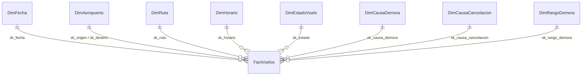

# 01 — Dimensional model (source of truth)

Values in quotes/tables (e.g. "A tiempo") are **data values stored in Spanish** — keep them exactly.

## Kimball decisions
| Step | Decision |
|---|---|
| Business process | JetBlue domestic flight operations |
| Grain | **1 row = 1 scheduled flight** (incl. cancelled and diverted) |
| Dimensions | 8 |
| Facts | 11 measures in `FactVuelos` |

Star schema. `DimAeropuerto` is role-playing (origin and destination: one table, two FKs).



## Dimensions

### D1 `DimFecha` — full calendar for the window (not only dates with flights)
| Field | Type | Meaning | Source |
|---|---|---|---|
| sk_fecha | INT PK | YYYYMMDD (e.g. 20260715) | FlightDate |
| fecha | DATE | Flight date | FlightDate |
| anio | SMALLINT | Year | derived |
| trimestre | TINYINT | 1–4 | derived |
| mes | TINYINT | 1–12 | derived |
| nombre_mes | NVARCHAR(15) | Enero…Diciembre (Spanish) | derived |
| nombre_dia | NVARCHAR(15) | Lunes…Domingo (Spanish) | derived |
| es_fin_semana | BIT | 1 if Sat/Sun | derived |
| es_feriado | BIT | 1 if US federal holiday (`holidays` lib) | derived |

### D2 `DimAeropuerto` — role-playing origin/destination
| Field | Type | Meaning | Source |
|---|---|---|---|
| sk_aeropuerto | INT IDENTITY PK | Surrogate key | — |
| codigo_iata | CHAR(3) UNIQUE | JFK, BOS… | Origin / Dest |
| ciudad | NVARCHAR(60) | "New York, NY" | OriginCityName / DestCityName |
| estado | CHAR(2) | NY, FL… | OriginState / DestState |
| nombre_estado | NVARCHAR(50) | State name | OriginStateName / DestStateName |
| es_base_principal | BIT | 1 if top-5 airport by JetBlue departures in window | computed in ETL |
| latitud | DECIMAL(9,6) NULL | Latitude (for the map) | OurAirports `airports.csv` by `iata_code` (fallback: `ident` = "K"+IATA) |
| longitud | DECIMAL(9,6) NULL | Longitude (for the map) | same |

### D3 `DimRuta` — origin–destination pair
| Field | Type | Meaning | Source |
|---|---|---|---|
| sk_ruta | INT IDENTITY PK | Surrogate key | — |
| ruta | VARCHAR(7) UNIQUE | "JFK-BOS" | Origin + Dest |
| origen | CHAR(3) | Origin code | Origin |
| destino | CHAR(3) | Destination code | Dest |
| distancia_millas | INT | Route distance | Distance |
| tipo_distancia | NVARCHAR(10) | Corta (<700 mi), Media (700–1500), Larga (>1500) | derived |

### D4 `DimHorario` — scheduled departure hour (24 fixed rows)
| Field | Type | Meaning | Source |
|---|---|---|---|
| sk_horario | TINYINT PK | Hour 0–23 | CRSDepTime // 100 (2400 → 0) |
| bloque | CHAR(9) | "0600-0659" | derived |
| franja | NVARCHAR(12) | Madrugada (0–5), Mañana (6–11), Tarde (12–17), Noche (18–23) | derived |

### D5 `DimEstadoVuelo` (4 fixed rows) — rule evaluated in this order: cancelled → diverted → delayed → on time
| sk_estado | estado | Rule |
|---|---|---|
| 3 | Cancelado | `Cancelled = 1` |
| 4 | Desviado | `Diverted = 1` |
| 2 | Demorado | `ArrDel15 = 1` (arrived ≥15 min late) |
| 1 | A tiempo | otherwise |
Fields: `sk_estado TINYINT PK`, `estado NVARCHAR(15)`, `descripcion NVARCHAR(120)` (short Spanish description).

### D6 `DimCausaDemora` (8 fixed rows)
Main cause = the BTS cause with the most minutes (BTS cause minutes only exist when arrival delay ≥15).
| sk | codigo | causa | controlable | Meaning |
|---|---|---|---|---|
| 0 | NAP | No aplica | — | Cancelled or diverted |
| 1 | NON | Sin demora | — | On time |
| 2 | CAR | Aerolínea | Sí | Maintenance, crew, cleaning, baggage, boarding |
| 3 | WEA | Clima | No | Extreme weather |
| 4 | NAS | Control de tráfico aéreo | No | Congestion, flow control, non-extreme weather |
| 5 | SEC | Seguridad | No | Evacuations, re-screening |
| 6 | LAT | Avión anterior retrasado | Parcial | Late-arriving aircraft (chain delay) |
| 7 | UNK | Sin dato | — | Delayed but BTS reported no causes |
Fields: `sk_causa_demora TINYINT PK`, `codigo CHAR(3)`, `causa NVARCHAR(40)`, `controlable NVARCHAR(10)`.

### D7 `DimCausaCancelacion` (5 fixed rows)
| sk | codigo | causa | controlable |
|---|---|---|---|
| 0 | N | No cancelado | — |
| 1 | A | Aerolínea | Sí |
| 2 | B | Clima | No |
| 3 | C | Control de tráfico aéreo | No |
| 4 | D | Seguridad | No |
Fields: `sk_causa_cancelacion TINYINT PK`, `codigo CHAR(1)`, `causa NVARCHAR(40)`, `controlable NVARCHAR(10)`.

### D8 `DimRangoDemora` — arrival delay range (6 fixed rows)
| sk | rango | min_desde | min_hasta | orden |
|---|---|---|---|---|
| 0 | No aplica (cancelado/desviado) | NULL | NULL | 6 |
| 1 | Llegó antes de hora | NULL | -1 | 1 |
| 2 | A tiempo (0–14 min) | 0 | 14 | 2 |
| 3 | Leve (15–44 min) | 15 | 44 | 3 |
| 4 | Moderada (45–119 min) | 45 | 119 | 4 |
| 5 | Grave (120+ min) | 120 | NULL | 5 |
Fields: `sk_rango_demora TINYINT PK`, `rango NVARCHAR(30)`, `min_desde INT NULL`, `min_hasta INT NULL`, `orden TINYINT`.

## Fact `FactVuelos`
| Field | Type | Meaning | BTS source |
|---|---|---|---|
| id_vuelo | BIGINT IDENTITY PK | Row id | — |
| sk_fecha | INT FK | → DimFecha | FlightDate |
| sk_origen | INT FK | → DimAeropuerto (origin) | Origin |
| sk_destino | INT FK | → DimAeropuerto (destination) | Dest |
| sk_ruta | INT FK | → DimRuta | Origin+Dest |
| sk_horario | TINYINT FK | → DimHorario | CRSDepTime |
| sk_estado | TINYINT FK | → DimEstadoVuelo | rule |
| sk_causa_demora | TINYINT FK | → DimCausaDemora | rule |
| sk_causa_cancelacion | TINYINT FK | → DimCausaCancelacion | CancellationCode |
| sk_rango_demora | TINYINT FK | → DimRangoDemora | rule on ArrDelay |
| numero_vuelo | INT | Degenerate dim | Flight_Number_Reporting_Airline |
| matricula | VARCHAR(10) NULL | Tail number, degenerate dim | Tail_Number |
| demora_salida_min | INT NULL | Departure delay (negative = early). NULL if cancelled | DepDelay |
| demora_llegada_min | INT NULL | Arrival delay (negative = early). NULL if cancelled/diverted | ArrDelay |
| taxi_out_min | INT NULL | Gate-to-takeoff minutes (congestion) | TaxiOut |
| es_puntual | TINYINT | 1 if status = A tiempo | rule |
| es_cancelado | TINYINT | 1 if cancelled | Cancelled |
| es_desviado | TINYINT | 1 if diverted | Diverted |
| min_causa_aerolinea | INT NULL | Carrier delay minutes | CarrierDelay |
| min_causa_clima | INT NULL | Weather minutes | WeatherDelay |
| min_causa_trafico | INT NULL | NAS minutes | NASDelay |
| min_causa_seguridad | INT NULL | Security minutes | SecurityDelay |
| min_causa_avion_tardio | INT NULL | Late aircraft minutes | LateAircraftDelay |
| origen_registro | VARCHAR(5) | 'ETL' or 'APP' (inserted from dashboard) | — |
| fecha_carga | DATETIME2 | Load timestamp (DEFAULT SYSDATETIME()) | — |

- Flags are `TINYINT` not `BIT` (SQL Server can't `SUM()` a BIT).
- Natural key `(sk_fecha, numero_vuelo, sk_origen)` → UNIQUE index.
- **Do not impute NULLs with 0.** A cancelled flight has no delay ("not applicable", not zero).

## KPIs (computed in queries, NOT stored)
| KPI | SQL |
|---|---|
| % Puntualidad | `SUM(es_puntual)*1.0 / COUNT(*)` (all scheduled flights; cancelled and diverted count as not on time — DOT Air Travel Consumer Report definition) |
| % Cancelación | `SUM(es_cancelado)*1.0 / COUNT(*)` |
| Avg delay of delayed flights | `AVG(demora_llegada_min)` where `sk_estado = 2` |
| Cause share | `SUM(min_causa_X)*1.0 / NULLIF(SUM(all 5 causes), 0)` where `sk_estado = 2` |
| Avg taxi-out | `AVG(taxi_out_min)` |
Ratios are always **sum / sum**, never averages of percentages.

## DDL (T-SQL)
```sql
CREATE TABLE DimFecha (
    sk_fecha INT PRIMARY KEY, fecha DATE NOT NULL UNIQUE, anio SMALLINT NOT NULL,
    trimestre TINYINT NOT NULL, mes TINYINT NOT NULL, nombre_mes NVARCHAR(15) NOT NULL,
    nombre_dia NVARCHAR(15) NOT NULL, es_fin_semana BIT NOT NULL, es_feriado BIT NOT NULL);

CREATE TABLE DimAeropuerto (
    sk_aeropuerto INT IDENTITY(1,1) PRIMARY KEY, codigo_iata CHAR(3) NOT NULL UNIQUE,
    ciudad NVARCHAR(60) NULL, estado CHAR(2) NULL, nombre_estado NVARCHAR(50) NULL,
    es_base_principal BIT NOT NULL DEFAULT 0,
    latitud DECIMAL(9,6) NULL, longitud DECIMAL(9,6) NULL);

CREATE TABLE DimRuta (
    sk_ruta INT IDENTITY(1,1) PRIMARY KEY, ruta VARCHAR(7) NOT NULL UNIQUE,
    origen CHAR(3) NOT NULL, destino CHAR(3) NOT NULL,
    distancia_millas INT NULL, tipo_distancia NVARCHAR(10) NULL);

CREATE TABLE DimHorario (
    sk_horario TINYINT PRIMARY KEY, bloque CHAR(9) NOT NULL, franja NVARCHAR(12) NOT NULL);

CREATE TABLE DimEstadoVuelo (
    sk_estado TINYINT PRIMARY KEY, estado NVARCHAR(15) NOT NULL, descripcion NVARCHAR(120) NULL);

CREATE TABLE DimCausaDemora (
    sk_causa_demora TINYINT PRIMARY KEY, codigo CHAR(3) NOT NULL,
    causa NVARCHAR(40) NOT NULL, controlable NVARCHAR(10) NULL);

CREATE TABLE DimCausaCancelacion (
    sk_causa_cancelacion TINYINT PRIMARY KEY, codigo CHAR(1) NOT NULL,
    causa NVARCHAR(40) NOT NULL, controlable NVARCHAR(10) NULL);

CREATE TABLE DimRangoDemora (
    sk_rango_demora TINYINT PRIMARY KEY, rango NVARCHAR(30) NOT NULL,
    min_desde INT NULL, min_hasta INT NULL, orden TINYINT NOT NULL);

CREATE TABLE FactVuelos (
    id_vuelo BIGINT IDENTITY(1,1) PRIMARY KEY,
    sk_fecha INT NOT NULL REFERENCES DimFecha(sk_fecha),
    sk_origen INT NOT NULL REFERENCES DimAeropuerto(sk_aeropuerto),
    sk_destino INT NOT NULL REFERENCES DimAeropuerto(sk_aeropuerto),
    sk_ruta INT NOT NULL REFERENCES DimRuta(sk_ruta),
    sk_horario TINYINT NOT NULL REFERENCES DimHorario(sk_horario),
    sk_estado TINYINT NOT NULL REFERENCES DimEstadoVuelo(sk_estado),
    sk_causa_demora TINYINT NOT NULL REFERENCES DimCausaDemora(sk_causa_demora),
    sk_causa_cancelacion TINYINT NOT NULL REFERENCES DimCausaCancelacion(sk_causa_cancelacion),
    sk_rango_demora TINYINT NOT NULL REFERENCES DimRangoDemora(sk_rango_demora),
    numero_vuelo INT NOT NULL, matricula VARCHAR(10) NULL,
    demora_salida_min INT NULL, demora_llegada_min INT NULL, taxi_out_min INT NULL,
    es_puntual TINYINT NOT NULL, es_cancelado TINYINT NOT NULL, es_desviado TINYINT NOT NULL,
    min_causa_aerolinea INT NULL, min_causa_clima INT NULL, min_causa_trafico INT NULL,
    min_causa_seguridad INT NULL, min_causa_avion_tardio INT NULL,
    origen_registro VARCHAR(5) NOT NULL DEFAULT 'ETL',
    fecha_carga DATETIME2 NOT NULL DEFAULT SYSDATETIME());

CREATE UNIQUE INDEX UX_Fact_Natural ON FactVuelos (sk_fecha, numero_vuelo, sk_origen);
CREATE INDEX IX_Fact_Fecha  ON FactVuelos (sk_fecha);
CREATE INDEX IX_Fact_Origen ON FactVuelos (sk_origen, sk_fecha);
```
