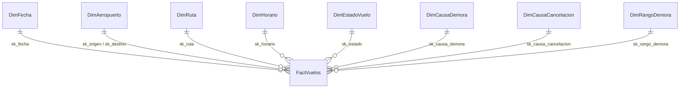

# 01 — Modelo dimensional (fuente de verdad)

## Decisiones de Kimball

| Paso | Decisión |
|---|---|
| Proceso de negocio | Operación de vuelos domésticos de JetBlue |
| Grano | **1 fila = 1 vuelo programado** (incluye cancelados y desviados) |
| Dimensiones | 8 (abajo) |
| Hechos | 11 métricas en `FactVuelos` |

Esquema en **estrella**. `DimAeropuerto` se usa dos veces (origen y destino): es una dimensión *role-playing* (una tabla, dos claves foráneas).

## Diagrama



## Dimensiones

### D1 `DimFecha` — calendario (se genera para toda la ventana, no solo fechas con vuelos)
| Campo | Tipo | Descripción | Origen |
|---|---|---|---|
| sk_fecha | INT PK | Fecha como número `AAAAMMDD` (ej. 20260715) | FlightDate |
| fecha | DATE | Fecha del vuelo | FlightDate |
| anio | SMALLINT | Año | derivado |
| trimestre | TINYINT | 1–4 | derivado |
| mes | TINYINT | 1–12 | derivado |
| nombre_mes | NVARCHAR(15) | Enero…Diciembre (en español) | derivado |
| nombre_dia | NVARCHAR(15) | Lunes…Domingo (en español) | derivado |
| es_fin_semana | BIT | 1 si sábado o domingo | derivado |
| es_feriado | BIT | 1 si es feriado federal de EE. UU. (librería `holidays`) | derivado |

### D2 `DimAeropuerto` — aeropuertos (role-playing: origen y destino)
| Campo | Tipo | Descripción | Origen |
|---|---|---|---|
| sk_aeropuerto | INT IDENTITY PK | Clave subrogada | — |
| codigo_iata | CHAR(3) UNIQUE | Código del aeropuerto (JFK, BOS…) | Origin / Dest |
| ciudad | NVARCHAR(60) | Ciudad, ej. "New York, NY" | OriginCityName / DestCityName |
| estado | CHAR(2) | Código de estado (NY, FL…) | OriginState / DestState |
| nombre_estado | NVARCHAR(50) | Nombre del estado | OriginStateName / DestStateName |
| es_base_principal | BIT | 1 si está entre los 5 aeropuertos con más salidas de JetBlue en la ventana | calculado en el ETL |

### D3 `DimRuta` — par origen–destino
| Campo | Tipo | Descripción | Origen |
|---|---|---|---|
| sk_ruta | INT IDENTITY PK | Clave subrogada | — |
| ruta | VARCHAR(7) UNIQUE | "JFK-BOS" | Origin + Dest |
| origen | CHAR(3) | Aeropuerto de salida | Origin |
| destino | CHAR(3) | Aeropuerto de llegada | Dest |
| distancia_millas | INT | Distancia de la ruta | Distance |
| tipo_distancia | NVARCHAR(10) | Corta (<700 mi), Media (700–1500), Larga (>1500) | derivado |

### D4 `DimHorario` — hora programada de salida (24 filas fijas)
| Campo | Tipo | Descripción | Origen |
|---|---|---|---|
| sk_horario | TINYINT PK | Hora de salida programada (0–23) | CRSDepTime ÷ 100 (2400 → 0) |
| bloque | CHAR(9) | "0600-0659" | derivado |
| franja | NVARCHAR(12) | Madrugada (0–5), Mañana (6–11), Tarde (12–17), Noche (18–23) | derivado |

### D5 `DimEstadoVuelo` — resultado del vuelo (4 filas fijas)
| sk_estado | estado | Regla (en este orden) |
|---|---|---|
| 1 | A tiempo | No cancelado, no desviado y llegó con < 15 min de demora |
| 2 | Demorado | Llegó con ≥ 15 min de demora (`ArrDel15 = 1`) |
| 3 | Cancelado | `Cancelled = 1` |
| 4 | Desviado | `Diverted = 1` |
Campos: `sk_estado TINYINT PK`, `estado NVARCHAR(15)`, `descripcion NVARCHAR(120)`.

### D6 `DimCausaDemora` — causa principal de la demora (8 filas fijas)
La causa principal es la que más minutos aportó entre las 5 causas del BTS (solo existen cuando el vuelo llegó ≥15 min tarde).

| sk | codigo | causa | controlable | Significado |
|---|---|---|---|---|
| 0 | NAP | No aplica | — | Vuelo cancelado o desviado |
| 1 | NON | Sin demora | — | Llegó a tiempo |
| 2 | CAR | Aerolínea | Sí | Mantenimiento, tripulación, limpieza, equipaje, embarque |
| 3 | WEA | Clima | No | Clima severo |
| 4 | NAS | Control de tráfico aéreo | No | Congestión, control de flujo, clima no severo (National Airspace System) |
| 5 | SEC | Seguridad | No | Evacuaciones, re-inspección |
| 6 | LAT | Avión anterior retrasado | Parcial | El avión llegó tarde de su vuelo previo (demora "en cadena") |
| 7 | UNK | Sin dato | — | Demorado pero el BTS no informó causas |
Campos: `sk_causa_demora TINYINT PK`, `codigo CHAR(3)`, `causa NVARCHAR(40)`, `controlable NVARCHAR(10)`.

### D7 `DimCausaCancelacion` (5 filas fijas)
| sk | codigo | causa | controlable |
|---|---|---|---|
| 0 | N | No cancelado | — |
| 1 | A | Aerolínea | Sí |
| 2 | B | Clima | No |
| 3 | C | Control de tráfico aéreo | No |
| 4 | D | Seguridad | No |
Campos: `sk_causa_cancelacion TINYINT PK`, `codigo CHAR(1)`, `causa NVARCHAR(40)`, `controlable NVARCHAR(10)`.

### D8 `DimRangoDemora` — rango de demora en la llegada (6 filas fijas)
| sk | rango | min_desde | min_hasta | orden |
|---|---|---|---|---|
| 0 | No aplica (cancelado/desviado) | NULL | NULL | 6 |
| 1 | Llegó antes de hora | NULL | -1 | 1 |
| 2 | A tiempo (0–14 min) | 0 | 14 | 2 |
| 3 | Leve (15–44 min) | 15 | 44 | 3 |
| 4 | Moderada (45–119 min) | 45 | 119 | 4 |
| 5 | Grave (120+ min) | 120 | NULL | 5 |
Campos: `sk_rango_demora TINYINT PK`, `rango NVARCHAR(30)`, `min_desde INT NULL`, `min_hasta INT NULL`, `orden TINYINT`.

## Tabla de hechos `FactVuelos`

| Campo | Tipo | Descripción | Origen BTS |
|---|---|---|---|
| id_vuelo | BIGINT IDENTITY PK | Identificador de la fila | — |
| sk_fecha | INT FK | → DimFecha | FlightDate |
| sk_origen | INT FK | → DimAeropuerto (rol origen) | Origin |
| sk_destino | INT FK | → DimAeropuerto (rol destino) | Dest |
| sk_ruta | INT FK | → DimRuta | Origin+Dest |
| sk_horario | TINYINT FK | → DimHorario | CRSDepTime |
| sk_estado | TINYINT FK | → DimEstadoVuelo | regla |
| sk_causa_demora | TINYINT FK | → DimCausaDemora | regla |
| sk_causa_cancelacion | TINYINT FK | → DimCausaCancelacion | CancellationCode |
| sk_rango_demora | TINYINT FK | → DimRangoDemora | regla sobre ArrDelay |
| numero_vuelo | INT | Número de vuelo (dimensión degenerada) | Flight_Number_Reporting_Airline |
| matricula | VARCHAR(10) NULL | Matrícula del avión (degenerada; permite seguir un avión en el día) | Tail_Number |
| demora_salida_min | INT NULL | Minutos de retraso en la salida (negativo = salió antes). NULL si cancelado | DepDelay |
| demora_llegada_min | INT NULL | Minutos de retraso en la llegada (negativo = llegó antes). NULL si cancelado/desviado | ArrDelay |
| taxi_out_min | INT NULL | Minutos desde que deja la puerta hasta despegar (indica congestión) | TaxiOut |
| es_puntual | TINYINT | 1 si estado = A tiempo | regla |
| es_cancelado | TINYINT | 1 si fue cancelado | Cancelled |
| es_desviado | TINYINT | 1 si fue desviado | Diverted |
| min_causa_aerolinea | INT NULL | Minutos de demora por la aerolínea | CarrierDelay |
| min_causa_clima | INT NULL | Minutos por clima | WeatherDelay |
| min_causa_trafico | INT NULL | Minutos por control de tráfico aéreo | NASDelay |
| min_causa_seguridad | INT NULL | Minutos por seguridad | SecurityDelay |
| min_causa_avion_tardio | INT NULL | Minutos por avión anterior retrasado | LateAircraftDelay |
| origen_registro | VARCHAR(5) | 'ETL' o 'APP' (insertado desde el dashboard) | — |
| fecha_carga | DATETIME2 | Fecha de carga (DEFAULT SYSDATETIME()) | — |

- Los flags son `TINYINT` (no `BIT`) porque SQL Server no permite `SUM()` sobre `BIT`.
- Clave natural única: `(sk_fecha, numero_vuelo, sk_origen)` → índice `UNIQUE` para evitar duplicados.
- Nulos: **no se imputan con 0**. Un cancelado no tiene demora: es "no aplica", no "cero".

## KPIs (se calculan en las consultas, NO se guardan)

| KPI | Fórmula SQL |
|---|---|
| % Puntualidad | `SUM(es_puntual) * 1.0 / NULLIF(COUNT(*) - SUM(es_cancelado), 0)` (sobre vuelos operados) |
| % Cancelación | `SUM(es_cancelado) * 1.0 / COUNT(*)` |
| Demora promedio de los vuelos demorados | `AVG(demora_llegada_min)` filtrando `sk_estado = 2` |
| Participación de una causa | `SUM(min_causa_X) * 1.0 / NULLIF(SUM(las 5 causas), 0)` filtrando `sk_estado = 2` |
| Taxi-out promedio | `AVG(taxi_out_min)` |

Regla: las razones se calculan como **suma / suma**, nunca como promedio de porcentajes ya calculados.

## DDL (T-SQL)

```sql
CREATE TABLE DimFecha (
    sk_fecha INT PRIMARY KEY, fecha DATE NOT NULL UNIQUE, anio SMALLINT NOT NULL,
    trimestre TINYINT NOT NULL, mes TINYINT NOT NULL, nombre_mes NVARCHAR(15) NOT NULL,
    nombre_dia NVARCHAR(15) NOT NULL, es_fin_semana BIT NOT NULL, es_feriado BIT NOT NULL);

CREATE TABLE DimAeropuerto (
    sk_aeropuerto INT IDENTITY(1,1) PRIMARY KEY, codigo_iata CHAR(3) NOT NULL UNIQUE,
    ciudad NVARCHAR(60) NULL, estado CHAR(2) NULL, nombre_estado NVARCHAR(50) NULL,
    es_base_principal BIT NOT NULL DEFAULT 0);

CREATE TABLE DimRuta (
    sk_ruta INT IDENTITY(1,1) PRIMARY KEY, ruta VARCHAR(7) NOT NULL UNIQUE,
    origen CHAR(3) NOT NULL, destino CHAR(3) NOT NULL,
    distancia_millas INT NULL, tipo_distancia NVARCHAR(10) NULL);

CREATE TABLE DimHorario (
    sk_horario TINYINT PRIMARY KEY, bloque CHAR(9) NOT NULL, franja NVARCHAR(12) NOT NULL);

CREATE TABLE DimEstadoVuelo (
    sk_estado TINYINT PRIMARY KEY, estado NVARCHAR(15) NOT NULL, descripcion NVARCHAR(120) NULL);

CREATE TABLE DimCausaDemora (
    sk_causa_demora TINYINT PRIMARY KEY, codigo CHAR(3) NOT NULL,
    causa NVARCHAR(40) NOT NULL, controlable NVARCHAR(10) NULL);

CREATE TABLE DimCausaCancelacion (
    sk_causa_cancelacion TINYINT PRIMARY KEY, codigo CHAR(1) NOT NULL,
    causa NVARCHAR(40) NOT NULL, controlable NVARCHAR(10) NULL);

CREATE TABLE DimRangoDemora (
    sk_rango_demora TINYINT PRIMARY KEY, rango NVARCHAR(30) NOT NULL,
    min_desde INT NULL, min_hasta INT NULL, orden TINYINT NOT NULL);

CREATE TABLE FactVuelos (
    id_vuelo BIGINT IDENTITY(1,1) PRIMARY KEY,
    sk_fecha INT NOT NULL REFERENCES DimFecha(sk_fecha),
    sk_origen INT NOT NULL REFERENCES DimAeropuerto(sk_aeropuerto),
    sk_destino INT NOT NULL REFERENCES DimAeropuerto(sk_aeropuerto),
    sk_ruta INT NOT NULL REFERENCES DimRuta(sk_ruta),
    sk_horario TINYINT NOT NULL REFERENCES DimHorario(sk_horario),
    sk_estado TINYINT NOT NULL REFERENCES DimEstadoVuelo(sk_estado),
    sk_causa_demora TINYINT NOT NULL REFERENCES DimCausaDemora(sk_causa_demora),
    sk_causa_cancelacion TINYINT NOT NULL REFERENCES DimCausaCancelacion(sk_causa_cancelacion),
    sk_rango_demora TINYINT NOT NULL REFERENCES DimRangoDemora(sk_rango_demora),
    numero_vuelo INT NOT NULL, matricula VARCHAR(10) NULL,
    demora_salida_min INT NULL, demora_llegada_min INT NULL, taxi_out_min INT NULL,
    es_puntual TINYINT NOT NULL, es_cancelado TINYINT NOT NULL, es_desviado TINYINT NOT NULL,
    min_causa_aerolinea INT NULL, min_causa_clima INT NULL, min_causa_trafico INT NULL,
    min_causa_seguridad INT NULL, min_causa_avion_tardio INT NULL,
    origen_registro VARCHAR(5) NOT NULL DEFAULT 'ETL',
    fecha_carga DATETIME2 NOT NULL DEFAULT SYSDATETIME());

CREATE UNIQUE INDEX UX_Fact_Natural ON FactVuelos (sk_fecha, numero_vuelo, sk_origen);
CREATE INDEX IX_Fact_Fecha  ON FactVuelos (sk_fecha);
CREATE INDEX IX_Fact_Origen ON FactVuelos (sk_origen, sk_fecha);
```
